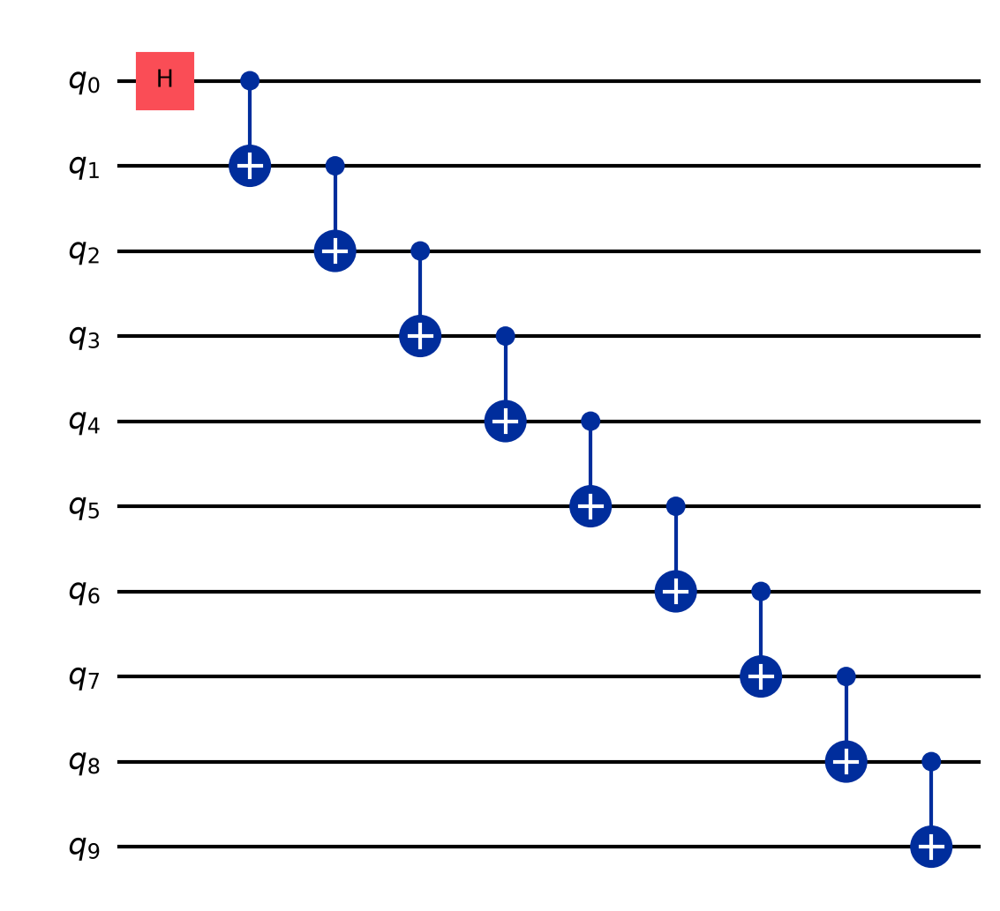
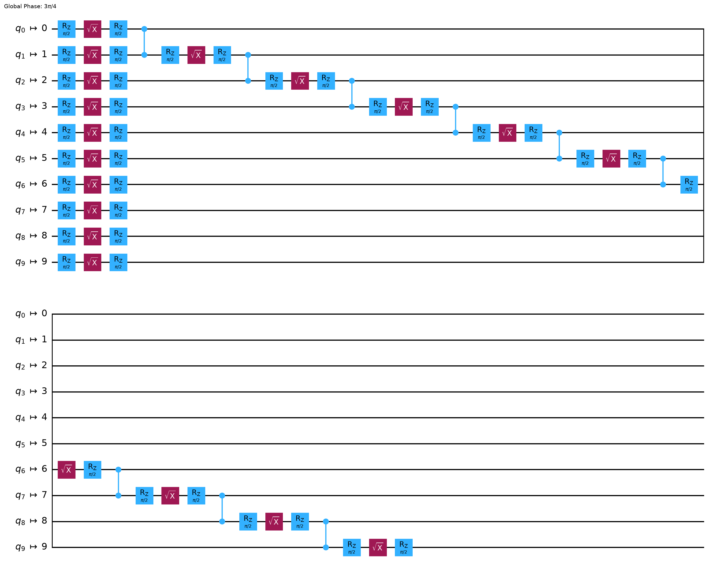
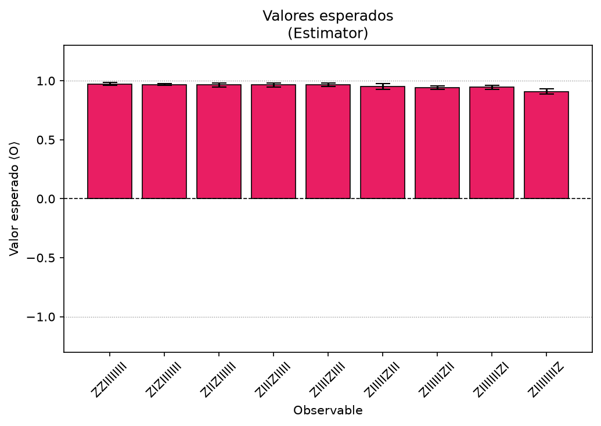
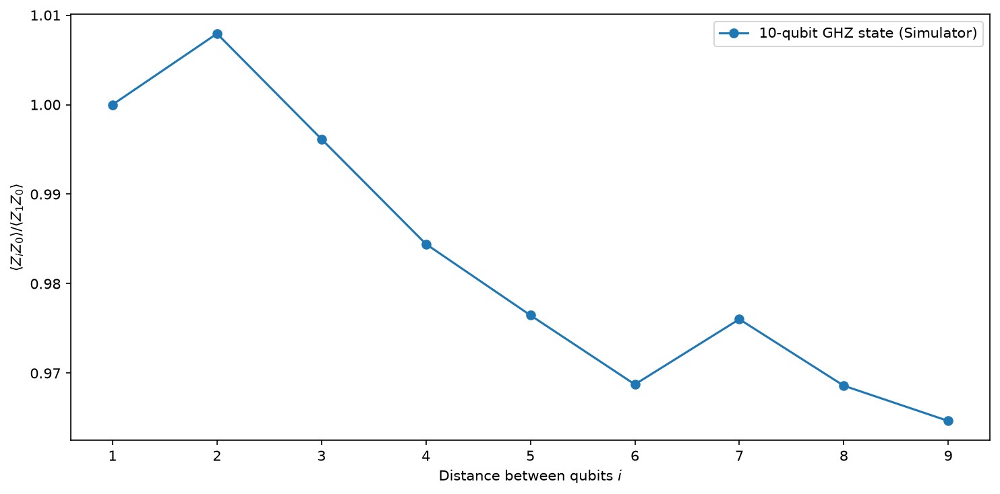
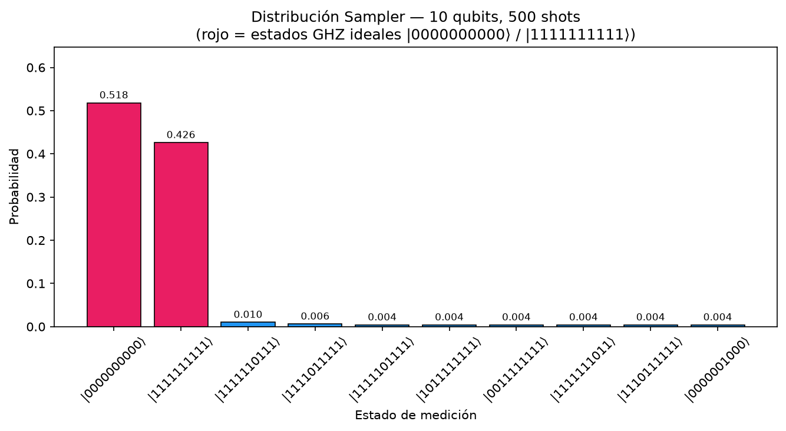

# BellGHZPrimitives

> **Exploring quantum entanglement at scale using IBM Quantum Primitives**  
> A structured implementation of the [IBM Quantum "Hello World" tutorial](https://quantum.cloud.ibm.com/docs/en/guides/hello-world) — extended from a 2-qubit Bell state to an n-qubit GHZ state, with full support for both **Estimator** and **Sampler** primitives, simulator and real hardware execution.

---

## The Story

Quantum computers don't work like classical computers. They manipulate **qubits** — quantum bits that can exist in superposition, and become **entangled** with each other in ways that have no classical equivalent.

This project starts from the simplest possible quantum phenomenon — the **Bell state** — and scales it up to a **GHZ state** across `n` qubits. Along the way, it answers a fundamental question:

> *How does quantum correlation decay as qubits get farther apart in a real (noisy) device?*

### From Bell to GHZ

A **Bell state** entangles exactly 2 qubits:

$$|\Phi^+\rangle = \frac{1}{\sqrt{2}}\left(|00\rangle + |11\rangle\right)$$

A **GHZ state** generalizes this to `n` qubits:

$$|GHZ_n\rangle = \frac{1}{\sqrt{2}}\left(|0\rangle^{\otimes n} + |1\rangle^{\otimes n}\right)$$

Both are created by the same circuit pattern: a Hadamard gate on qubit 0, followed by a cascade of CNOT gates.

```
q_0: -H-*-----------
         |
q_1: ----X-*--------
             |
q_2: --------X-*---
                 |
q_n: ------------X-
```

### The 4-Step Qiskit Pattern

This project follows the canonical **Qiskit Patterns** workflow:

| Step | What happens |
|---|---|
| **1. Map** | Build the GHZ circuit and define ZZ observables |
| **2. Optimize** | Transpile to the backend's ISA (basis gates + qubit connectivity) |
| **3. Execute** | Run with **Estimator** (expectation values) or **Sampler** (bitstring distributions) |
| **4. Analyze** | Visualize ZZ correlations and GHZ decay, export to CSV |

---

## Results

### Step 1 — Bell State Circuit

The 2-qubit Bell state circuit before transpilation:



### Step 2 — ISA Circuit (after transpilation)

After the pass manager optimizes and maps the circuit to the backend's instruction set:



### Step 3 — Estimator: ZZ Correlations (10 qubits, 500 shots)

The Estimator measures the expected value ⟨ZᵢZ₀⟩ for each qubit pair. In a perfect GHZ state all values should be 1.0. The slight decay reveals simulator noise:



### Step 4 — GHZ Decay (10 qubits, 500 shots)

As the distance between qubits increases, the ZZ correlation degrades — this is the fingerprint of noise in a quantum device:

$$\frac{\langle Z_i Z_0 \rangle}{\langle Z_1 Z_0 \rangle} \xrightarrow{i \to n} \text{noise floor}$$



### Step 5 — Sampler: Bitstring Distribution (10 qubits, 500 shots)

The Sampler measures raw bitstring probabilities. A perfect 10-qubit GHZ state should collapse to only `|0000000000⟩` and `|1111111111⟩` with equal probability ~50% each. The residual states represent decoherence:



---

## Project Structure

```
BellGHZPrimitives/
|
+-- main.py                          <- Entry point (PRIMITIVE, MODE, N_QUBITS, N_SHOTS)
+-- requirements.txt
|
+-- src/
|   +-- CircuitDefinition/
|   |   +-- 01_map_problem_to_quantum_native.py   # Bell state circuit + observables
|   |   +-- 01_ghz_state_generator.py             # n-qubit GHZ circuit generator
|   |
|   +-- CircuitOptimization/
|   |   +-- 02_circuits_operators_optimization.py # Transpilation to ISA
|   |
|   +-- PrimitiveExecution/
|       +-- 03_quantum_estimator_simulator.py     # Estimator on GenericBackendV2
|       +-- 03_quantum_estimator_execution.py     # Estimator on IBM Quantum hardware
|       +-- 03_quantum_sampler_simulator.py       # Sampler on GenericBackendV2
|       +-- 03_quantum_sampler_execution.py       # Sampler on IBM Quantum hardware
|
+-- utils/
|   +-- config/
|   |   +-- arg_parser.py     # CLI argument parsing (N_QUBITS, N_SHOTS, PRIMITIVE, MODE)
|   |   +-- env.py            # Environment variable exports
|   |   +-- qiskit_save_account.py
|   |
|   +-- helpers/
|   |   +-- quantum_setup.py  # Shared setup: backend, transpilation, ISA context
|   |
|   +-- visualization/
|       +-- estimator.py      # plot_estimator_results, plot_ghz_decay
|       +-- sampler.py        # plot_sampler_results
|
+-- outputs/
    +-- data/
    |   +-- 03_bell_state_results_estimator_simulator.csv
    |   +-- 03_ghz_state_results_sampler_simulator.csv
    +-- figures/
        +-- 01_bell_state_circuit.png
        +-- 02_isa_circuit.png
        +-- 03_*.png
```

---

## Usage

### Prerequisites

```bash
pip install -r requirements.txt
```

For IBM Quantum hardware access, save your credentials once:

```python
from qiskit_ibm_runtime import QiskitRuntimeService

QiskitRuntimeService.save_account(
    token="<your-api-key>",   # IBM Quantum Platform dashboard
    instance="<your-CRN>",    # IBM Quantum Instances page
)
```

### Run from `main.py`

All parameters are passed via CLI. `main.py` routes to the correct script automatically.

```bash
# Syntax
python main.py [PRIMITIVE=estimator|sampler] [MODE=simulator|hardware] \
               [N_QUBITS=<int>] [N_SHOTS=<int>]
```

#### Examples

```bash
# Estimator on simulator — 10 qubits, 500 shots (default)
python main.py

# Sampler on simulator — 5 qubits, 200 shots
python main.py PRIMITIVE=sampler N_QUBITS=5 N_SHOTS=200

# Estimator on real IBM Quantum hardware — 2 qubits, 1000 shots
python main.py PRIMITIVE=estimator MODE=hardware N_QUBITS=2 N_SHOTS=1000

# Sampler on real IBM Quantum hardware
python main.py PRIMITIVE=sampler MODE=hardware N_QUBITS=10 N_SHOTS=4000
```

#### Output

```
=======================================================
  BellGHZPrimitives
  PRIMITIVE : ESTIMATOR
  MODE      : SIMULATOR
  N_QUBITS  : 10
  N_SHOTS   : 500
  Script    : src/PrimitiveExecution/03_quantum_estimator_simulator.py
=======================================================
Circuito cargado: 10 qubits | N_QUBITS=10
>>> Shots configurados: 500
>>> Job ID: 9722b634-...

--- Resultados Estimator (Simulator) ---
Observable     Valor esperado      +/- Std
------------------------------------------
ZZIIIIIIII             0.9921     0.0054
ZIZIIIIIII             0.9881     0.0074
...
CSV guardado en outputs/data/03_bell_state_results_estimator_simulator.csv
```

### Parameter reference

| Parameter | Values | Default | Description |
|---|---|---|---|
| `PRIMITIVE` | `estimator` \| `sampler` | `estimator` | Quantum primitive to use |
| `MODE` | `simulator` \| `hardware` | `simulator` | Execution target |
| `N_QUBITS` | integer >= 2 | `2` | Number of qubits in the GHZ state |
| `N_SHOTS` | integer | `100` | Number of circuit executions |

---

## Output Files

### CSV (in `outputs/data/`)

| File | Primitive | Columns |
|---|---|---|
| `03_bell_state_results_estimator_simulator.csv` | Estimator | `observable, expected_value, std, n_qubits, n_shots` |
| `03_bell_state_results_estimator_q_hardware.csv` | Estimator | `observable, expected_value, std, n_qubits, n_shots` |
| `03_ghz_state_results_sampler_simulator.csv` | Sampler | `bitstring, counts, probability, n_qubits, n_shots` |
| `03_ghz_state_results_sampler_q_hardware.csv` | Sampler | `bitstring, counts, probability, n_qubits, n_shots` |

### Figures (in `outputs/figures/`)

| File | Description |
|---|---|
| `01_bell_state_circuit.png` | GHZ circuit diagram |
| `02_isa_circuit.png` | Transpiled ISA circuit |
| `03_bell_state_results_estimator_*` | Bar chart + heatmap of expected values |
| `03_ghz_decay_estimator_*` | ZZ correlation decay with qubit distance |
| `03_ghz_state_results_sampler_*` | Bitstring probability distribution |

---

## Key Concepts

### Primitives

IBM Quantum exposes two fundamental execution primitives:

| Primitive | Returns | Use when |
|---|---|---|
| **Estimator** | Expectation values ⟨O⟩ +/- std | You want to measure observables (energy, correlations) |
| **Sampler** | Bitstring distribution (counts) | You want measurement outcomes / state distributions |

### Error Mitigation

- **Estimator** uses `resilience_level=1` — automatic measurement error mitigation.
- **Hardware Estimator** additionally enables `dynamical_decoupling` with `XY4` sequence to suppress idle qubit decoherence.

### ISA Circuits

Before execution, circuits are transpiled to the backend's **Instruction Set Architecture (ISA)** — mapping virtual qubits to physical qubits and decomposing gates into native operations. This is handled by `utils/helpers/quantum_setup.py`.

---

## References

- [IBM Quantum "Run your first circuit on hardware"](https://quantum.cloud.ibm.com/docs/en/guides/hello-world)
- [Qiskit Estimator primitive](https://quantum.cloud.ibm.com/docs/en/guides/get-started-with-estimator)
- [Qiskit Sampler primitive](https://quantum.cloud.ibm.com/docs/en/guides/get-started-with-sampler)
- [Error mitigation and suppression techniques](https://quantum.cloud.ibm.com/docs/en/guides/error-mitigation-and-suppression-techniques)
- [Qiskit Patterns workflow](https://quantum.cloud.ibm.com/docs/en/guides/intro-to-patterns)

---

## Author

**Juan David Prada Malagón**  
Built following the IBM Quantum Platform documentation and extended with multi-qubit GHZ scaling, dual-primitive support, and a structured Python project architecture.
